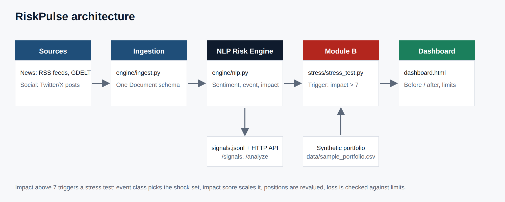

# RiskPulse: AI/NLP Risk Engine + Event-Driven Portfolio Stress Testing (Module B)

RiskPulse reads unstructured text (news and social posts), turns each item into a structured risk
signal, and uses high-impact signals to trigger stress tests on a synthetic wholesale-banking portfolio.



```
 News (RSS feeds / GDELT / files) ─┐
                                 ├─► Ingestion ─► NLP Risk Engine ─► signals.jsonl / HTTP API
 Tweets / X posts (files) ───────┘                 sentiment · event class · impact (1-10)
                                                              │
                                                              ▼
                              Module B: trigger when impact > 7 ─► shock library ─► revaluation
                                                              │
                                                              ▼
                                      stress_results.json  +  dashboard.html (before / after)
```

## Submission deliverables

| # | Deliverable | Location |
|---|---|---|
| 1 | Source code and architecture diagram | this repo, [`docs/architecture.png`](docs/architecture.png) (also [SVG](docs/architecture.svg)) |
| 2 | Presentation deck (7 slides) | [`docs/presentation.pdf`](docs/presentation.pdf), editable [`docs/presentation.pptx`](docs/presentation.pptx) |
| 3 | Demo video walkthrough | **TODO: paste your unlisted YouTube link here** (script: [`docs/demo_video_script.md`](docs/demo_video_script.md)) |
| 4 | All data used | [`data/`](data/): `sample_news.json`, `sample_tweets.json`, `sample_portfolio.csv` (all synthetic or hand-written, nothing proprietary) |

## Quick start

```bash
python app.py                   # opens the interactive app at http://localhost:8000
python -m unittest              # 20 tests
python run_pipeline.py          # headless run; writes output/ (signals, stress results, static dashboard)
```

Python 3.9+ and the standard library only: no installs, no API keys. Optional extras are in `requirements.txt`.

### The app

| Tab | What you can do |
|---|---|
| **Stress tests** | See which headlines triggered a stress test, the portfolio value before and after, loss against the warning and breach limits, the shocks assumed, and what drove the loss. |
| **Headlines** | Search and filter every scored headline. Click a row for a plain-English explanation of its score. |
| **Analyze your own** | Paste any headline or tweet and get its tone, event type and impact. Add it to the feed or run a what-if on it. |
| **What-if scenario** | Pick an event, region and severity (or a preset like "Taiwan crisis") and see the effect on the portfolio. |
| **How it works** | Four-step explanation and a glossary. |

A **Sensitivity** slider sets the impact level above which a headline triggers a stress test (default 7).
`output/dashboard.html` is a static snapshot of the same UI that opens without a server.

### Live headlines

Click **Live headlines** in the app (or start with `python app.py --live`). RiskPulse then pulls current
headlines from public RSS feeds of news channels (BBC, NYT, Guardian, WSJ, Bloomberg; no API key) and from
GDELT, scores them, and runs the stress tests on them. Edit `data/feeds.json` to add, remove or disable feeds.
A feed that is down is skipped and shown as "unavailable" under *feed details*; if every source fails, the
app keeps showing the previous data and says so.

Social posts need a paid API, so live mode shows news only. Paste tweets under **Analyze your own**
(choose "Social post") to bring social text into the engine. The bundled sample data includes both
news and Twitter-style posts.

Other commands:

```bash
python app.py --port 9000 --no-browser         # custom port, no auto-open
python run_pipeline.py --threshold 6.5         # fire stress tests earlier
python run_pipeline.py --scenario "Geopolitical" --impact 9 --region Asia   # manual what-if in the snapshot
python run_pipeline.py --live                  # NewsAPI (set NEWSAPI_KEY) + GDELT in the headless run
python run_pipeline.py --finbert               # FinBERT sentiment (pip install transformers torch)
python run_pipeline.py --serve                 # plain JSON API on :8000 (GET /signals, POST /analyze)
```

## 1. The AI/NLP Risk Engine (`engine/`)

| Requirement | Implementation |
|---|---|
| ≥ 2 data sources | News (live RSS feeds, GDELT, NewsAPI, or `sample_news.json`) and Twitter/X-style posts (`sample_tweets.json`, or pasted in the app). All normalised into one `Document` schema (`engine/ingest.py`, `engine/live.py`). |
| Sentiment score (-1 to 1) | Finance lexicon with negation and intensifier handling, squashed with `tanh` (`engine/nlp.py`). Optional FinBERT. |
| Event classification | Weighted pattern classifier over 10 classes: Geopolitical, Macroeconomic, Credit Event, Merger/Acquisition, Product Launch, Regulatory, Cyber/Operational, Natural Disaster, Earnings, Other. Returns a confidence. |
| Impact score (1-10) | Event-class base severity + sentiment (negative news weighted higher) + severity terms + magnitude cues ($ amounts, %) + social reach, then scaled by source credibility. Every component is returned in `rationale`. |
| Output | `output/signals.jsonl`, plus an HTTP API: `GET /signals?min_impact=7`, `POST /analyze {"text": "..."}`. |

Example signal:

```json
{"signal_id": "sig-n03", "source": "news", "event_type": "Credit Event", "event_confidence": 0.99,
 "sentiment_score": -0.96, "sentiment_label": "Negative", "impact_score": 10.0,
 "entities": ["DB"], "region": "Europe",
 "rationale": {"base": 6.5, "sentiment_adj": 2.4, "severity_terms": 1.2, "magnitude": 0.54, "source_weight": 1.0}}
```

The default engine is rule-based on purpose: it is transparent, instant, offline, and every score can be
explained to a risk reviewer. The `RiskAnalyzer` interface is the swap point for a fine-tuned model
(see "Extending" below).

## 2. Module B: strategic portfolio stress testing (`stress/`)

**Portfolio** (`data/sample_portfolio.csv`, 76 positions, about $4.0B): loans, corporate and government
bonds, interest-rate swaps, FX forwards, equity options, and equities across 8 sectors, 6 regions and 5
currencies. Regenerate with `python generate_portfolio.py`. `stress/portfolio.py::from_transactions`
maps a transaction file (Salad Money, Kaggle Financial Transactions) onto loan exposures so real
transaction data can seed the book.

**Trigger** (`StressTester.triggered`): any signal with `impact_score > 7` fires a stress test. Signals
are grouped by (event type, region); the worst one leads, and the others are shown as corroboration
(for example the same event confirmed by both news and Twitter).

**Shocks** (`stress/scenarios.py`): each event class has a shock set (equity %, yield bp, spread bp, FX by
currency bucket, sector multipliers). Shocks scale linearly with the impact score and are concentrated in
the event's region.

| Event | Equity | Yields | Spreads | Notable |
|---|---|---|---|---|
| Geopolitical | -15% | -50 bp | +110 bp | EM FX -7%, JPY/CHF up |
| Macroeconomic | -10% | +125 bp | +70 bp | Real estate, tech hit harder |
| Credit Event | -12% | -25 bp | +180 bp | Financials 1.7x |
| Cyber/Operational | -8% | -10 bp | +60 bp | Financials, tech |
| Natural Disaster | -7% | -5 bp | +80 bp | 2x in-region, 0.4x elsewhere |

(Table shows full severity, impact = 10. An impact of 8 applies 80% of each shock.)

**Revaluation** (`stress/revalue.py`), P&L split into rates / credit / equity / FX:

- Equity: market value × beta × equity shock
- Bonds: duration-convexity for rates, spread duration for credit
- Loans: spread mark-down plus expected-loss uplift (PD scaled by spread widening × LGD)
- Swaps: DV01-style, so pay-fixed gains when rates rise; plus CVA on in-the-money trades
- FX forwards: notional × FX shock; equity options: delta-gamma
- Non-USD assets carry FX translation P&L

**Limits**: portfolio loss beyond -2.5% is a WARNING and beyond -5% is a BREACH.

**Dashboard** (`output/dashboard.html`, one self-contained file): pick a triggered event, then see portfolio
value before and after, the loss against limits, the shocks applied, value by asset class, P&L by risk
factor, sector and region, the largest position losses, and the full engine signal feed with trigger status.

## Sample run (bundled data)

| Event | Region | Impact | P&L | Status |
|---|---|---|---|---|
| Geopolitical | Asia | 10.0 | -$186M (-4.7%) | WARNING |
| Credit Event | Europe | 10.0 | -$308M (-7.8%) | BREACH |
| Geopolitical | Middle East | 10.0 | -$178M (-4.5%) | WARNING |
| Cyber/Operational | Europe | 9.7 | -$101M (-2.5%) | WARNING |
| Macroeconomic | North America | 8.6 | -$349M (-8.8%) | BREACH |
| Natural Disaster | Asia | 7.8 | -$85M (-2.1%) | Within limits |

## Project layout

```
engine/      schema, lexicons, nlp (analyzer), ingest (files/NewsAPI/GDELT), live (RSS headlines), sink (JSONL + JSON API)
stress/      portfolio, scenarios (shock library), revalue (pricing), stress_test (trigger + aggregation)
dashboard/   app.html (the UI) + build_dashboard.py (static snapshot)
data/        sample news, tweets, portfolio
tests/       20 unit tests (engine, stress model, live feeds, web API)
app.py       interactive web app (server)    service.py   shared app logic
run_pipeline.py   headless end-to-end run
```

## Extending

- **Better NLP**: fine-tune on the Kaggle "Sentiment Analysis for Financial News" and "Tweet Sentiment's
  Impact on Stock Returns" datasets and return the same `RiskSignal`; nothing downstream changes.
- **Calibrated impact**: regress impact on realised index moves after historical GDELT events.
- **Real market data**: replace the assumed betas and durations with `yfinance` history.

## Limitations

Rule-based NLP misses sarcasm and context, and live headlines are often terse, so many will score low. The live feeds were tested against a local mock server and parsers, not against every publisher's production feed; check *feed details* in the app. The shocks are expert-style assumptions, not calibrated
to history. Pricing is first-order (no full revaluation, no correlations between shocks). Combined P&L
across events is additive and therefore conservative. This is a hackathon prototype, not a regulatory
capital model.
